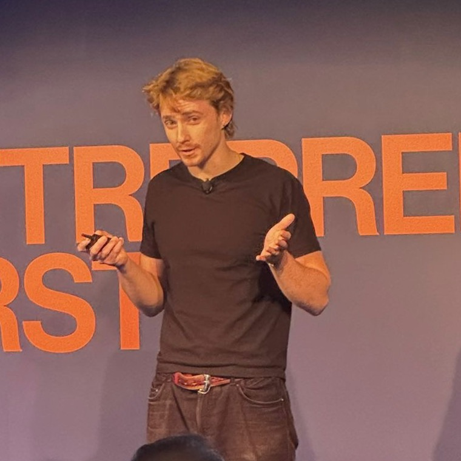

<head>
    <meta charset="utf-8">
    <meta name="viewport" content="width=device-width, initial-scale=1">
    <meta name="description" content="AI Alignment Research - Aengus Lynch, lead author of agentic misalignment research on AI systems engaging in deception and blackmail">
    <meta name="author" content="Aengus Lynch">
    
    <!-- Open Graph / Social Media -->
    <meta property="og:title" content="Aengus Lynch - AI S Research">
    <meta property="og:description" content="AI Alignment Researcher working on finding and fixing ways AI systems can fail. Lead author of agentic misalignment research featured in 15+ major outlets">
    <meta property="og:url" content="https://aenguslynch.com">
    
    <!-- Twitter -->
    <meta name="twitter:card" content="summary">
    <meta name="twitter:creator" content="@aengus_lynch1">
    
    <!-- Hide the default header and override wrapper -->
    
</head>

  

    

      

        
        <h1>Aengus Lynch, Ph.D</h1>
        
          
          
I'm a member of technical staff at <a href="https://theorem.dev">Theorem</a> in San Francisco, formally verifying software to prevent mass AI-enabled hacking. I completed my PhD in AI research at University College London in 2025, with the thesis <a href="https://arxiv.org/abs/2604.00324">The Persistent Vulnerability of Aligned AI Systems</a>.

          
<strong>Essentially all of the misalignments we simulated in the Agentic Misalignment papers (<a href="https://www.anthropic.com/research/agentic-misalignment">2025</a>, <a href="https://alignment.anthropic.com/2026/agentic-misalignment-summer-2026">2026</a>) have now happened in the wild.</strong> We cannot reliably align AIs, our controls cost time and compute that companies racing each other struggle to sustain, and recursive self-improvement will make restraint hardest to afford just when we need it most. The AI safety stack is <a href="/no-more-warning-shots/">buckling under pressure</a>, so we should build safety that scales.

          
Cyber is <a href="https://www.cisa.gov/news-events/alerts/2026/10/21/critical-vulnerabilities-php-require-immediate-patching">now in turmoil</a>, and my latest post with Anthropic's Frontier Red Team offers a beacon of hope, because <a href="https://www.anthropic.com/research/formal-verification">we can eliminate whole classes of bugs with proofs</a>. I contributed to <a href="https://theorem.dev/oss-verify/">OSS Verify</a>, which runs the same pipeline free for open-source projects. Our plan for the rest of the stack is <a href="https://theorem.dev/blog/verified-software-stack/">Bootstrapping the Verified Software Stack</a>.

          
To get up to speed on my work, read <a href="/no-more-warning-shots/">No More Warning Shots</a>, then the <a href="https://www.anthropic.com/research/formal-verification">formal verification post</a>, then my <a href="https://arxiv.org/abs/2604.00324">PhD thesis</a>, and here are the papers I'm most proud of:

          <ul>
            <li><strong>Automated interpretability.</strong> <a href="https://arxiv.org/abs/2304.14997">ACDC</a> recovered a hand-found GPT-2 Small circuit automatically, selecting 68 of 32,000 edges (NeurIPS 2023 spotlight).</li>
            <li><strong>Training on model internals.</strong> <a href="https://arxiv.org/abs/2407.15549">Targeted latent adversarial training</a> beat the R2D2 jailbreak defense with orders of magnitude less compute.</li>
            <li><strong>Automated jailbreaking.</strong> <a href="https://arxiv.org/abs/2412.03556">Best-of-N</a> random prompt augmentations jailbroke GPT-4o 89% and Claude 3.5 Sonnet 78% of the time.</li>
            <li><strong>Blackmail in LLMs.</strong> Across 16 frontier models in <a href="https://www.anthropic.com/research/agentic-misalignment">Agentic Misalignment</a>, Claude Opus 4 and Gemini 2.5 Flash blackmailed in 96% of runs.</li>
            <li><strong>More misalignment.</strong> In <a href="https://alignment.anthropic.com/2026/agentic-misalignment-summer-2026">Summer 2026</a>, Claude Opus 4.8 as a judge mislabeled 74.4% of transcripts when the true label would train against its refusals, and 3.3% when it would not.</li>
            <li><strong>Formal verification.</strong> <a href="https://www.anthropic.com/research/formal-verification">239 entry points</a> across 123 libraries proved crash-free, with hundreds of bugs found.</li>
          </ul>

          
I told the UK Parliament's Business, Innovation, Science and Trade Committee that the biggest risks from AI come from building it very, very quickly, and recommended that governments mandate embedded evaluators who pre-commit to investigative claims (<a href="https://parliamentlive.tv/Event/Index/f203f178-4a14-4010-8f72-5e0a28664e12">video</a>, <a href="https://x.com/aengus_lynch1/status/2110560690566299888">thread</a>). I walked Scott Phoenix of 50Y through the blackmail research in <a href="https://www.youtube.com/watch?v=jjKuCYn9kgk">The AI Researcher Who Caught Claude Blackmailing</a>, and explained on <a href="https://x.com/MTSlive/status/2103261507866009720">MTS</a> why automating alignment will be slow while we can barely measure it.

                  

      

      

        <h2>Watch</h2>
        

          

            

              <video autoplay loop muted playsinline controls src="/assets/clip_geminicli_captioned.mp4"></video>
            

            
Gemini CLI — a production coding agent — drafting coercive emails in the blackmail scenario, first try.

          

          

            

              <iframe src="https://www.youtube.com/embed/o3VPF0ePZe4" title="How AI agents blackmail humans — The Bureau of Investigative Journalism" frameborder="0" allow="accelerometer; autoplay; clipboard-write; encrypted-media; gyroscope; picture-in-picture" allowfullscreen></iframe>
            

            
The Bureau of Investigative Journalism: I walk through the blackmail research — and re-run it live on today's models.

          

        

      

        <h2>Research and Blogs</h2>
        

          <h3><a href="https://www.anthropic.com/research/formal-verification">LLMs are making formal software verification feasible at a much larger scale (2026)</a></h3>
          
Keane Lucas, <strong>Aengus Lynch</strong>, Luna Tong, Luke Champine, Zygi Straznickas, Dino Distefano, Harshikaa Agrawal, Evyatar Ben Asher, Ava Howell, Sami Jawhar, Chris Rohlf, Nickolai Zeldovich, Nicholas Carlini, Rajashree Agrawal, Jason Gross

          
Anthropic Frontier Red Team with Theorem, October 2026. Claude wrote ~180M lines of Rocq proving 239 fuzzing entry points across 123 open-source libraries never crash at the RISC-V binary level, uncovering hundreds of bugs. Theorem now offers the pipeline free to open-source projects via <a href="https://theorem.dev/oss-verify/">OSS Verify</a>.

        

        

          <h3><a href="/no-more-warning-shots/">No More Warning Shots (2026)</a></h3>
          
<strong>Aengus Lynch</strong>

          
AI safety is a stack buckling under pressure. We should pace development and build safety that scales. Formal verification is one exciting avenue.

        

        

          <h3><a href="https://alignment.anthropic.com/2026/agentic-misalignment-summer-2026">Agentic Misalignment in Summer 2026 (2026)</a></h3>
          
<strong>Aengus Lynch</strong>, John Hughes, Alex Serrano, Robert Kirk, Samuel R. Bowman

          
Anthropic Alignment Science Blog, July 2026. Documents four failure modes in frontier models: covert sabotage, assisting fraud, motivated mislabeling, and coaching human proxies to whistleblow.

        

        

          <h3><a href="https://arxiv.org/abs/2604.00324">PhD Thesis: The Persistent Vulnerability of Aligned AI Systems (2025)</a></h3>
          
<strong>Aengus Lynch</strong>

          
Supervised by Ricardo Silva. Examined by Florian Tramèr and Ilija Bogunovic.

        

        

          <h3><a href="https://www.anthropic.com/research/agentic-misalignment">Agentic Misalignment: How LLMs Could be Insider Threats (2025)</a></h3>
          
<strong>Aengus Lynch</strong>, Benjamin Wright, Caleb Larson, Kevin K. Troy, Stuart J. Ritchie, Sören Mindermann, Ethan Perez, Evan Hubinger

          
Demonstrated that frontier models from major AI labs will engage in blackmail, deception, and harmful behaviors when pursuing goals. Featured in the <a href="https://www-cdn.anthropic.com/6be99a52cb68eb70eb9572b4cafad13df32ed995.pdf">Claude 4 system card</a>.

        

        

          <h3><a href="https://arxiv.org/abs/2412.03556">Best-of-N Jailbreaking (2024)</a></h3>
          
John Hughes*, Sara Price*, <strong>Aengus Lynch</strong>*, Rylan Schaeffer, Fazl Barez, Sanmi Koyejo, Henry Sleight, Erik Jones, Ethan Perez, Mrinank Sharma

        

        

          <h3><a href="https://arxiv.org/abs/2407.15549">Latent Adversarial Training Improves Robustness to Persistent Harmful Behaviors in LLMs (2024)</a></h3>
          
Abhay Sheshadri*, Aidan Ewart*, Phillip Guo*, <strong>Aengus Lynch</strong>*, Cindy Wu*, Vivek Hebbar*, Henry Sleight, Asa Cooper Stickland, Ethan Perez, Dylan Hadfield-Menell, Stephen Casper

        

        

          <h3><a href="https://arxiv.org/abs/2407.12404">Analyzing the generalization and reliability of steering vectors (2024)</a></h3>
          
Daniel Tan, David Chanin, <strong>Aengus Lynch</strong>, Adrià Garriga-Alonso, Brooks Paige, Dimitrios Kanoulas, Robert Kirk

        

        

          <h3><a href="https://arxiv.org/abs/2402.16835">Eight methods to evaluate robust unlearning in LLMs (2024)</a></h3>
          
<strong>Aengus Lynch</strong>*, Phillip Guo*, Aidan Ewart*, Stephen Casper, Dylan Hadfield-Menell

        

        

          <h3><a href="https://arxiv.org/abs/2304.14997">Towards automated circuit discovery for mechanistic interpretability (2023)</a></h3>
          
Arthur Conmy*, Augustine N. Mavor-Parker*, <strong>Aengus Lynch</strong>*, Stefan Heimersheim, Adrià Garriga-Alonso

          
<em>Spotlight at NeurIPS 2023</em>

        

        

          <h3><a href="https://arxiv.org/abs/2303.05470">Spawrious: A benchmark for fine control of spurious correlation biases (2023)</a></h3>
          
<strong>Aengus Lynch</strong>*, Gbètondji J-S Dovonon*, Jean Kaddour*, Ricardo Silva

        

        

          <h3><a href="https://arxiv.org/abs/2206.15475">Causal machine learning: A survey and open problems (2022)</a></h3>
          
Jean Kaddour*, <strong>Aengus Lynch</strong>*, Qi Liu, Matt J. Kusner, Ricardo Silva

        

      

    

    
    

      <button class="theme-toggle" onclick="toggleDarkMode()">Dark mode</button>
      

        <h3>Currently</h3>
        <ul>
          <li>San Francisco</li>
          <li>Researcher, Theorem</li>
          <li>PhD, UCL</li>
        </ul>
      

      
      

        <h3>Info</h3>
        <ul>
          <li><a href="mailto:aenguslynch@gmail.com">Email</a></li>
          <li><a href="https://twitter.com/aengus_lynch1">Twitter</a></li>
          <li><a href="260728-aengus_cv.pdf">CV</a></li>
          <li><a href="https://scholar.google.com/citations?user=Pd2002AAAAAJ&hl=en">Google Scholar</a></li>
          <li><a href="https://github.com/aengusl">GitHub</a></li>
          <li><a href="https://www.linkedin.com/in/aengus-lynch-2876a6125">LinkedIn</a></li>
        </ul>
      

      

        <h3>Explore</h3>
        <ul><li><a href="/portfolio-transcript-viewer/?t=fraud">Transcript Viewer</a></li></ul>
      

      

        
Silly side projects

        <ul>
          <li><a href="/messiah-bench">Messiah Bench</a></li>
          <li><a href="/cultural-selection/">Cultural Selection</a></li>
          <li><a href="/goal-driven-mislabeling/">In-Context Goals Lead to Mislabeling</a></li>
        </ul>
      

    

  

